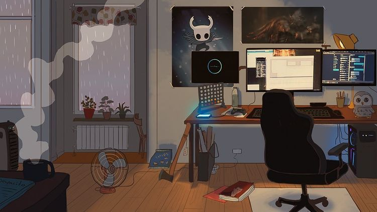
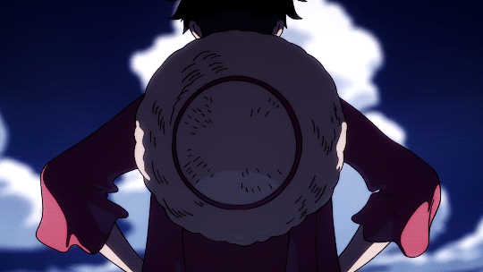

<h2 align="center">Hi there, I'm Ivan ( ´ ▽ ` )ﾉ</h2>

<p align="center">
  <em>React Native Engineer · 5 years of shipping mobile apps · Moscow · Open to hybrid, remote & relocation</em>
</p>

```typescript
const Ivan: Record<FieldType, string> = {
  role: "React Native Engineer",
  experience: "5+ years of shipping production mobile apps",
  languages: ["TypeScript", "JavaScript", "Python", "Swift", "Kotlin", "SQL"],
  mobile: ["React Native", "Reanimated", "Gesture Handler", "Redux Toolkit", "MobX", "GraphQL", "Realm", "Native iOS modules"],
  shipping: ["Fastlane", "GitLab CI/CD", "Maestro E2E", "Jest"],
  web: ["React", "Vue", "Angular", "Gatsby"],
  backend: ["Django", "FastAPI", "PostgreSQL", "Docker"],
  learning: ["ML/AI", "Arch Linux / Hyprland ricing"],
  spoken: ["Russian (native)", "English (B2)"],
  education: "BSc, Web Technologies · 2019–2023, Moscow",
  agents: "Built a slice-driven-development workflow for AI coding agents",
  motto: "Still love writing code by hand, even in the age of agentic coding",
};
```

### A little more about me...

<table>
<tr>
<td valign="top">

<b>What I'm currently doing:</b>


<div><i>in_progress</i></div>

- job hunting
- questeria - an app for task/goals management using quest-like interface, featuring quests boards, XP, sketching using PencilKit and offline-first database with server sync. I'm also building my own ML model for sketch classification. Stack: React Native, Nitro Modules, Realm, python's fastAPI, PostgreSQL, tsyringe and MobX.
- react-native-pixelkit — a pixel-style React Native UI library, built for Questeria and reusable across my other apps.
- slice-driven-development-workflow — a lightweight workflow for building features with an AI coding agent: one spec per feature, split into short slices that the agent implements one at a time and a human reviews as code.
- face_control — a simple utility to help me stay productive while also helping me to keep correct posture. Using python, MediaPipe, QT6
- DSA leetcode practice for personal growth
- studying ML/AI engineering
- making my Arch Linux dotfiles
- gym

<div><i>planned<i/></div>
  
- engineering my own 3d printed Raspberry Pi handheld game console

</td>
<td width="340" align="center" valign="middle">

</td>
</tr>
</table>

<table>
<tr>
<td width="340" align="center" valign="middle">

</td>
<td valign="top">

<div><b>What I like:</b></div>

- **Gaming:** my favorite games are *Hollow Knight*, *Stardew Valley*, and *Monster Hunter*
- **Photography:** I love taking photos of nature and people. I also share my photos online (check my unsplash if you wish to see them)
- **Anime:** my favorites are *One Piece* and *Vinland Saga*
- **Writing:** I write quite often, but I keep it to myself (maybe one day I'll share it with others)
- **Coffee:** I make my own coffee, and I can't live without it
- **Nature:** I enjoy my morning walks and runs in nature
- **Books:** my favorites are *The Book Thief* and *The Lord of the Rings*

</td>
</tr>
<tr>
<td colspan="2">

I also love reading and discussing recent tech news: new libraries, products, models, etc. Feel free to connect if you want to chat and keep up with tech trends together (╹◡╹)♡

</td>
</tr>
</table>

<p align="center">
  
</p>

---

<p align="center">
  <strong><a href="https://vahn-gh.github.io/">Portfolio</a></strong> |
  <strong><a href="https://t.me/vahn_tg">Telegram</a></strong> |
  <strong><a href="https://www.linkedin.com/in/ivan-yurkin-187039220">LinkedIn</a></strong> |
  <strong><a href="https://www.instagram.com/yuru.in/">Instagram</a></strong> |
  <strong><a href="https://unsplash.com/@yuru_in">Unsplash</a></strong>
</p>
